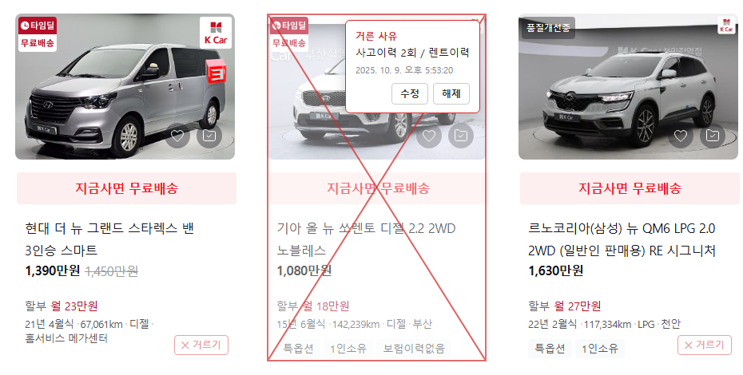

# 중고차 매물 거르기

엔카 · K Car 검색 목록에서 **내가 이미 확인하고 거른 매물**에 빨간 X 를 쳐두고,
마우스를 올리면 **왜 걸렀는지 메모**를 보여주는 크롬 확장 프로그램입니다.

매번 이력을 다시 열어보지 않아도, 새로 올라온 매물만 골라 볼 수 있습니다.

## 지원 사이트
- 엔카 — 국산/수입 검색 목록 (`encar.com/dc/dc_carsearchlist.do`), 차량 상세
- K Car — 직영중고차 검색 (`kcar.com/bc/search`), 차량 상세

## 설치 방법
웹스토어에 올리지 않았기 때문에 직접 불러와야 합니다. (1분이면 됩니다)

1. [Releases](../../releases) 에서 최신 `car-filter-extension-vX.X.X.zip` 을 받아 압축을 풉니다.
   (또는 이 페이지 상단 **Code → Download ZIP**)
2. 크롬 주소창에 `chrome://extensions` 입력
3. 오른쪽 위 **개발자 모드** 켜기
4. **압축해제된 확장 프로그램을 로드** → 압축 푼 폴더(`manifest.json` 이 들어있는 폴더) 선택
5. 엔카/K Car 검색 페이지를 새로고침

> 압축 푼 폴더를 지우면 확장도 동작하지 않으니, 지워지지 않을 곳에 두세요.

## 사용 방법
| 하고 싶은 것 | 방법 |
|---|---|
| 매물 거르기 | 매물 카드 오른쪽 아래 **✕ 거르기** → 사유 입력 → 저장 (Ctrl+Enter) |
| 사유 확인 | 거른 매물에 마우스 올리기 |
| 사유 수정 / 해제 | 마우스 올렸을 때 나오는 **수정** / **해제** |
| 상세 페이지에서 거르기 | 왼쪽 아래 **✕ 이 매물 거르기** 버튼 |
| 전체 목록 보기 · 검색 | 툴바의 확장 아이콘 클릭 |
| 백업 / 다른 PC 로 옮기기 | 아이콘 팝업의 **내보내기** → 다른 PC 에서 **가져오기** |

자주 쓰는 사유는 입력창 아래에 칩으로 떠서 클릭 한 번으로 재사용할 수 있습니다.

## 데이터
- 거른 목록은 **내 브라우저에만** 저장됩니다 (`chrome.storage.local`). 어디로도 전송하지 않습니다.
- 확장 프로그램을 삭제하면 목록도 지워지니, 필요하면 먼저 **내보내기**로 백업하세요.

## 업데이트
새 버전 zip 을 받아 **같은 폴더에 덮어쓴 뒤** `chrome://extensions` 에서 새로고침(↻) 하면 됩니다.
기존에 거른 목록은 유지됩니다.

## 동작하지 않을 때
사이트 화면이 개편되면 동작이 멈출 수 있습니다. [Issues](../../issues) 에 어느 사이트/어느 페이지인지 남겨주세요.
사이트별 셀렉터는 [`sites.js`](sites.js) 한 파일에 모여 있습니다. 구조 분석은 [개발 노트](docs/DEVELOPMENT.md) 참고.

## License
[MIT](LICENSE)
